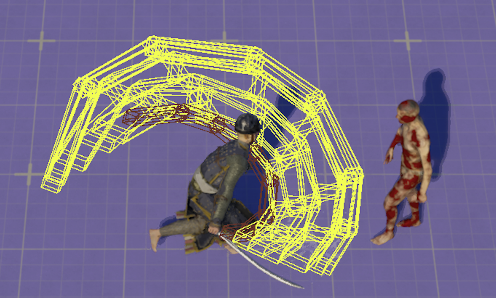

# Easy Trace-Trail System Overview

::plugin-links

## Video Overview

Watch this comprehensive tutorial to see **Easy Trace-Trail System** in action:

::youtube a8clpcFSLOE start=989

*This video demonstrates the complete workflow from setup to implementation.*

## Overview

**Easy Trace Trail System** is an **optimized**, **modular**, and **designer-friendly** **runtime** plugin for Unreal Engine that allows you to perform accurate hit trails along a mesh for a **duration** (On & Off). The system is powered by a World Subsystem, making it accessible from any object with world context—allowing programmers to trigger trails easily from anywhere in the game (Such as Gameplay Abilities, Actors, Actor Components etc.)

By defining **Sections** on a mesh, the system can determine exactly which part of the mesh generated the hit. This becomes extremely useful for mapping section-based damage, effects, or gameplay responses. Sections are defined using only a few sockets that represent the start and end points of each region—designers do not need to create one socket per segment.

The plugin **automatically calculates the correct spacing** and performs continuous traces **without gaps, ensuring highly accurate hit detection that feels fair to the player.

The hit detection parameters use the same configuration as Unreal Engine’s built-in tracing system, making it intuitive and very easy to adopt into existing workflows.

---

### ⭐ Key Benefits

* Optimized runtime trace trails along meshes

* Section-based detection for accurate damage or effects

* Automatically solves correct trace spacing—no gaps

* Minimal socket setup required

* Familiar settings based on Unreal’s tracing system

* Modular and easy to integrate into any project

---

### 🎮 Typical Use Cases

* Melee weapon trail hit detection

* Section-based damage zones (blade, hilt, handle, etc.)

* Ability or skill hit traces

* Precision hit validation in action or combat games

Though this plugin is easy to use, there are a few key concepts to understand to make the most of its powerful features. Further documentation will explain how to setup and use this system for your project.