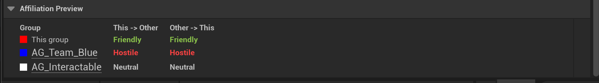

# Editor Tools and Debugging

## Affiliation Preview

Open any group asset and scroll to the bottom. The **Affiliation Preview** lists every group in the project:

| Column | Meaning |
| --- | --- |
| **Group** | The other group, in its debug color. Click to open it. |
| **This -> Other** | How this group sees that group. |
| **Other -> This** | How that group sees this group. |

When the two directions differ, the row is marked **One-sided**. Hover over an attitude to see which rule decided it.

The preview updates by itself while you edit, and it uses the same rules as the game, so what you see is what you get.

---

## Debug View

To see every actor's group while playing, type in the console:

`AffiliationSystem.EnableDebugMode 1`

Each actor with the *Stimuli Source Affiliation Group Member* component shows its group above it, in the group's debug color. Type `AffiliationSystem.EnableDebugMode 0` to turn it off.

<!-- TODO: add the debug view clip here: cd site && npm run video -- <export> ../content/docs/Extended-Affiliation-System, then ::video ./<name>.mp4 Debug view in game -->

:::note
The debug view only exists in Debug and Development builds, never in a shipped game.
:::

<!-- TODO: check in Play-In-Editor with several players that the debug view works in a client window and shows the right groups. -->

For more detail in the Output Log, type `Log LogExtendedAffiliationSystem VeryVerbose`.

---

## Troubleshooting

**Everyone is Neutral.**
Check that the groups have a decider, and that the actors have a group (turn on the debug view).

**Changing a group on a client does nothing.**
Groups can only be changed on the server.

**My pawn ignores its Default Affiliation Group.**
Its controller has a *Group Member Manager*, which decides the group. Set it there instead.

**By Gameplay Tag gives the wrong answer.**
It checks the **other** group's tags, Hostile first. Check that the other group has its tags filled in.

---

Questions, ideas or bugs? Join the **[Discord](https://discord.gg/mUm4hYvG3x)**.
