# Setup

Install the plugin from Fab (or get the source from [GitHub](https://github.com/Elmarath/ExtendedAffiliationSystem) and copy it into your project's `Plugins/` folder), enable **Extended Affiliation System** in *Edit → Plugins* and restart the editor. Everything below is done in the editor and in Blueprints.

---

## 1. Create Tags (Optional)

Tags describe what a group *is*. Add them under the **`Affiliation`** tag in *Project Settings → Gameplay Tags*. For example:

- `Affiliation.Group.Team`
- `Affiliation.Group.Team.Red`
- `Affiliation.Group.Team.Blue`

You only need tags for the *By Gameplay Tag* decider and the tag filter nodes.

---

## 2. Create Groups

Create one data asset per faction or team: *Content Browser → right click → Miscellaneous → Data Asset → Affiliation Group Data*.

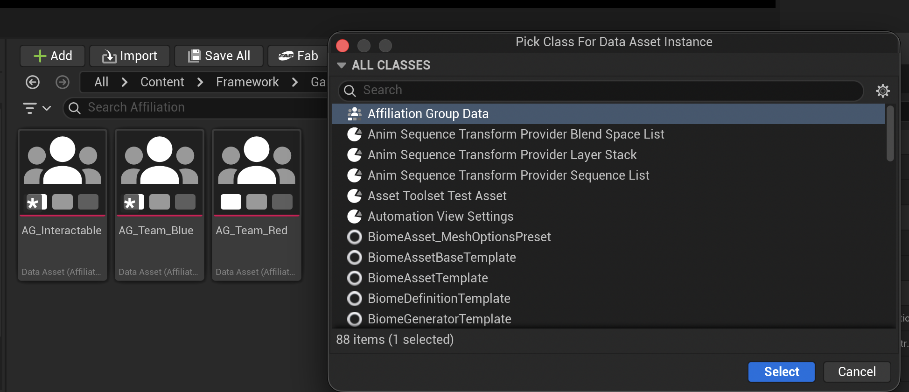

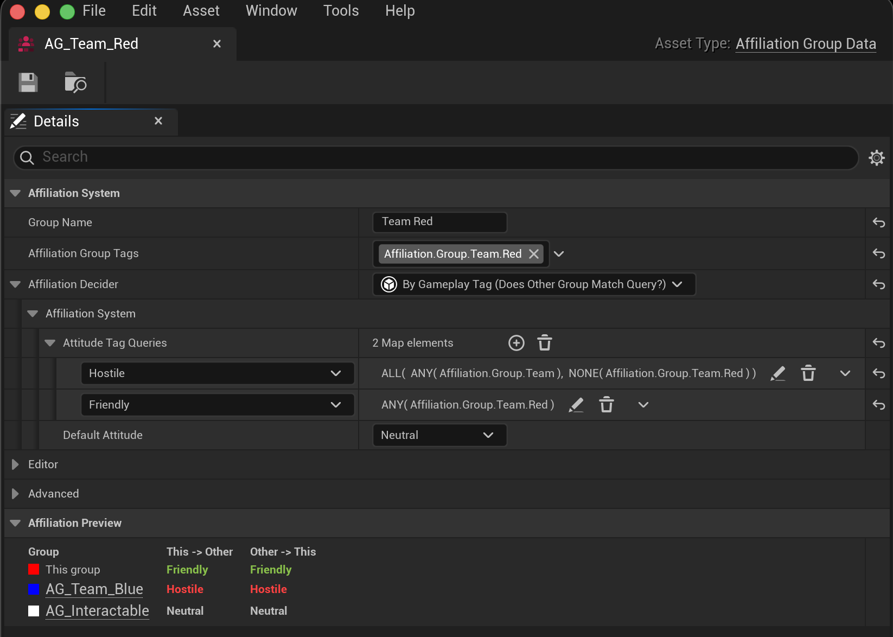

| Property | Description |
| --- | --- |
| **Group Name** | The group's name, shown in the debug view. |
| **Affiliation Group Tags** | What this group is. Other groups' rules can check these. |
| **Affiliation Decider** | How this group sees other groups. *Empty means Neutral to everyone.* |
| **Debug Color** | The group's color in the debug view and the preview. |
| **Preview Priority** | Higher numbers are listed first in the preview. |

Under *Advanced* there is also a **Metadata Map** for extra data like a color, an icon or a description for your UI.

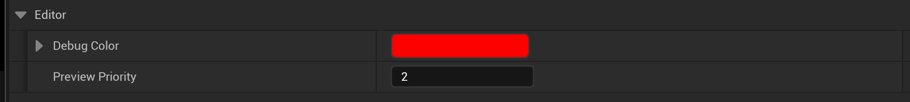

### Pick a Decider

The decider is the group's rule. Every decider has a **Default Attitude**, used when its rule doesn't apply.

| Decider | Use it when |
| --- | --- |
| **By Gameplay Tag** | Rules come from tags, like "hostile to every team that isn't Blue". |
| **By Explicit Reference** | You want to list the groups yourself. |
| **By Same Team** | Free-for-all: friendly to its own members, hostile to everyone else. |
| **Static** | The group sees everyone the same way, like neutral props. |
| **Universal (Both Ways)** | Everyone sees this group the same way, and it sees them the same, like wildlife no one fights. |

**By Gameplay Tag** has one tag query per attitude, tested against the *other* group's tags. It checks **Hostile first, then Friendly, then Neutral**. The first match wins.

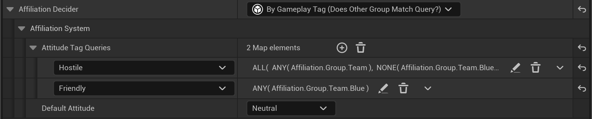

Here, Blue is *Hostile* to any team that isn't Blue, *Friendly* to Blue, and *Neutral* to everything else. Click the pencil icon to edit a query:

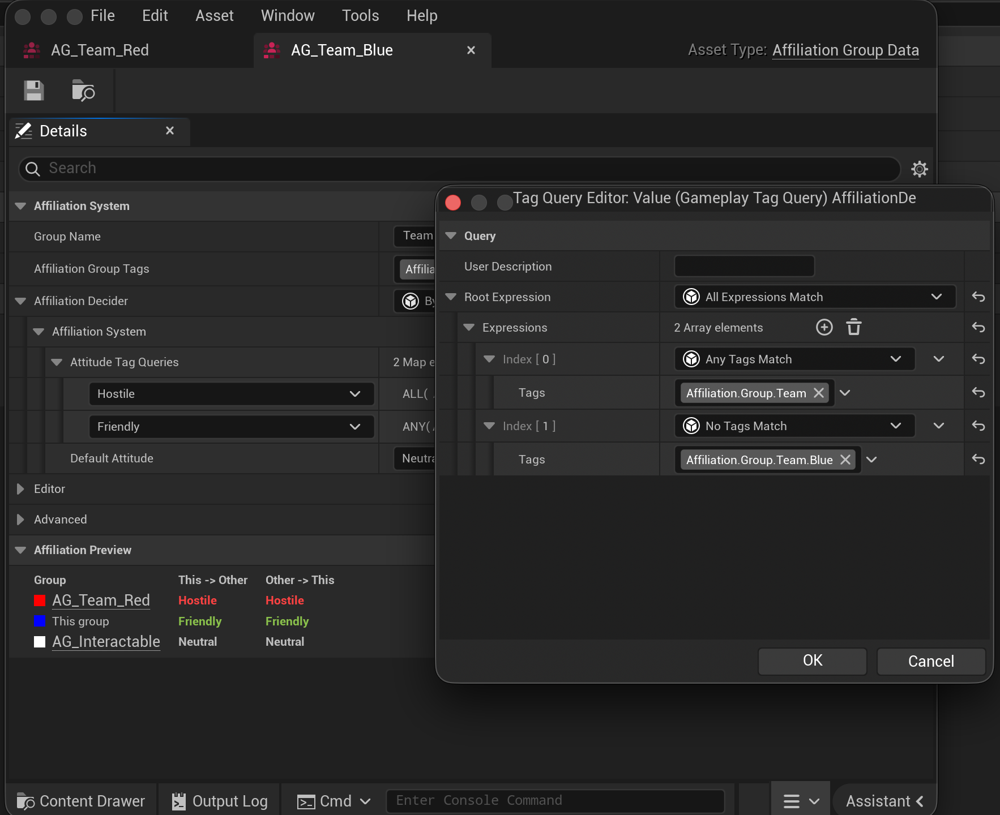

**By Explicit Reference** has one list of groups per attitude. A group may only be in one list.

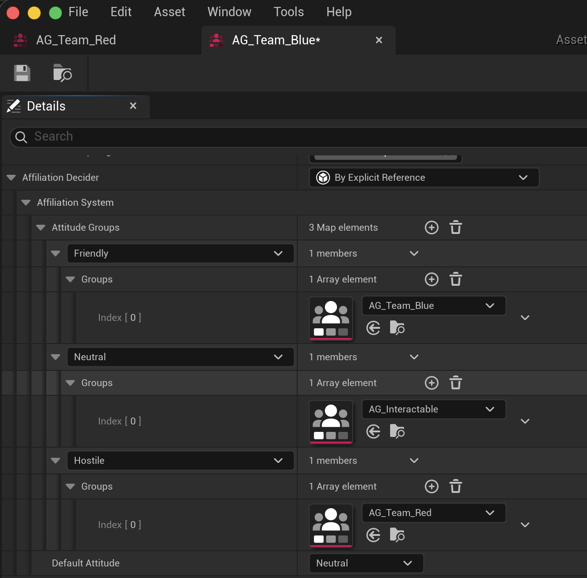

**By Same Team** sees its own members as *Same Team Attitude* and everyone else as *Default Attitude*.

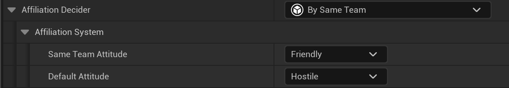

**Static** always answers *Default Attitude*.

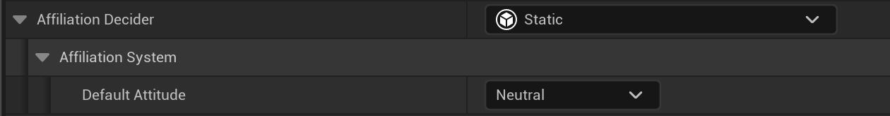

**Universal (Both Ways)** answers *Default Attitude* for itself **and** for every group looking at it, whatever their own rules say.

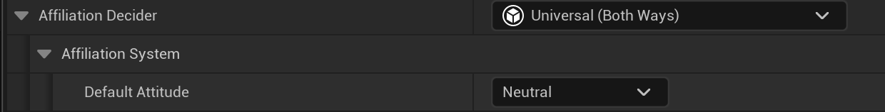

### Check the Preview

At the bottom of every group asset, the **Affiliation Preview** shows how this group and every other group see each other. Check it before you press Play.

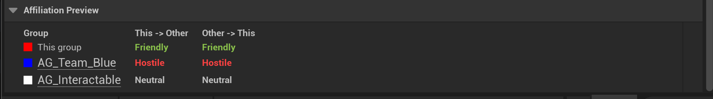

---

## 3. Put Actors in Groups

Add the **Stimuli Source Affiliation Group Member** component to the actor and set its **Default Affiliation Group**.

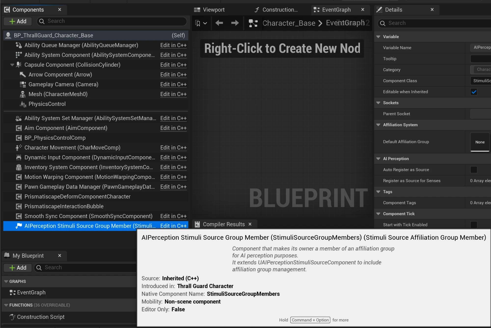

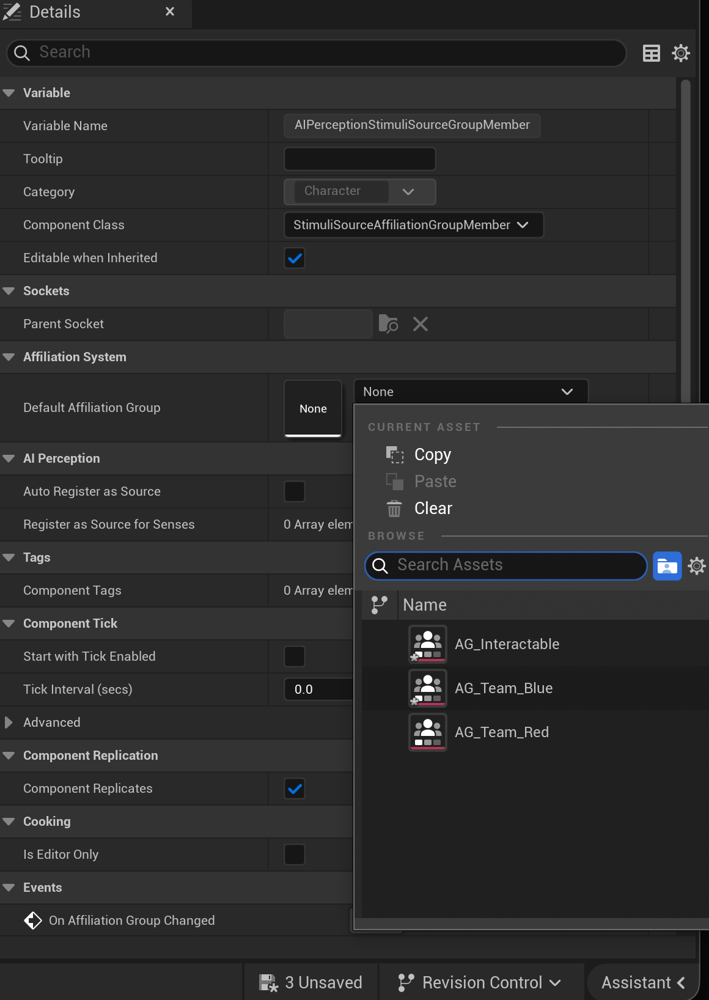

The component is also an *AI Perception Stimuli Source*, so AI can see and hear the actor with the same settings.

:::tip Keeping the group somewhere else
You can skip the component: add the **Extended Affiliation Actor Interface** to your actor and return its group from **Get Affiliation Group Data**. You then store and replicate the group yourself, and the debug view won't show the actor.

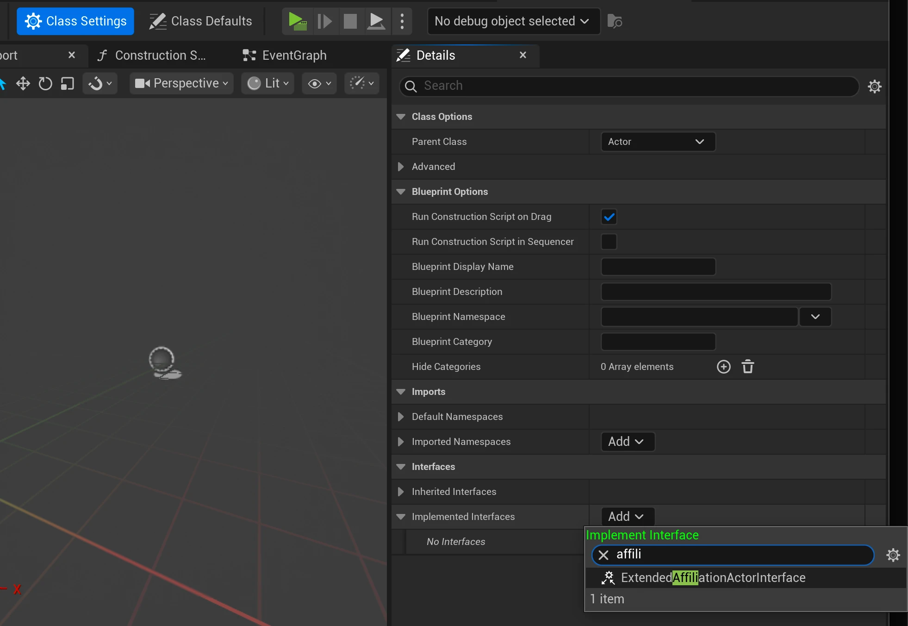

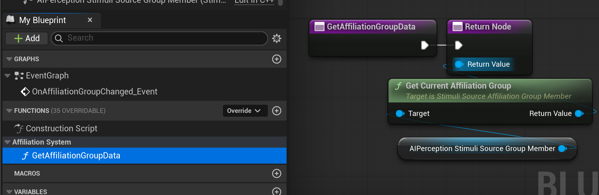
:::

---

## 4. Give Players and AI a Group

For players and AI, the group should belong to the *controller*, so it survives respawns.

1. Add the **Group Member Manager On Possessed Pawn** component to your *Player Controller* or *AI Controller*.
2. Set its **Default Affiliation Group On Possessed Pawn**.
3. Give your pawns the *Stimuli Source Affiliation Group Member* component. The manager writes the group into it.

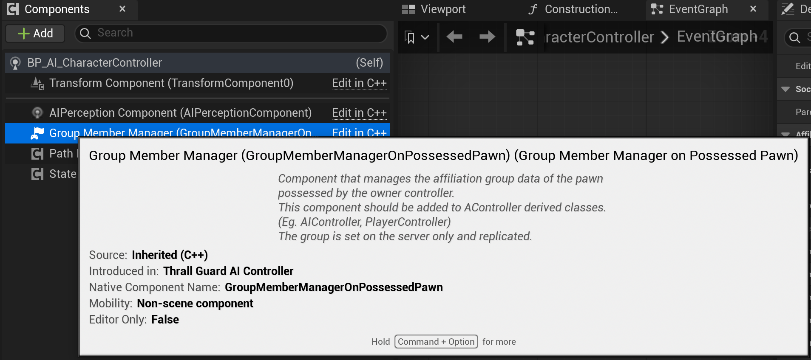

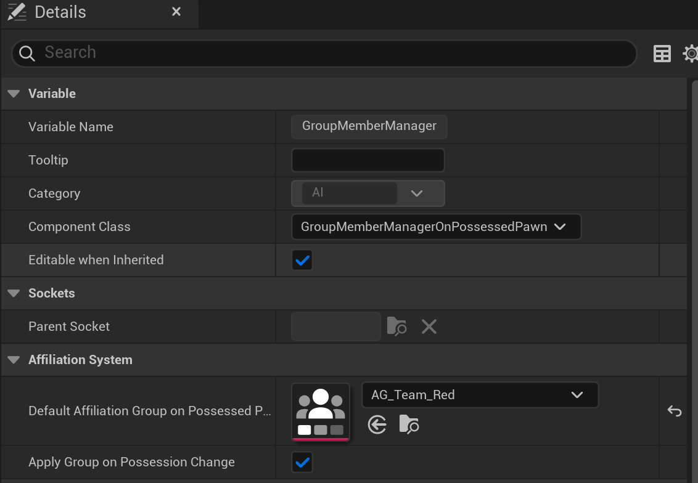

With **Apply Group On Possession Change** checked (the default), every pawn the controller possesses gets its group: after a respawn, in a vehicle, and so on.

:::note
A pawn controlled by a controller with a manager always uses the **controller's** group, not its own *Default Affiliation Group*.
:::

That's it. Let's use it!
