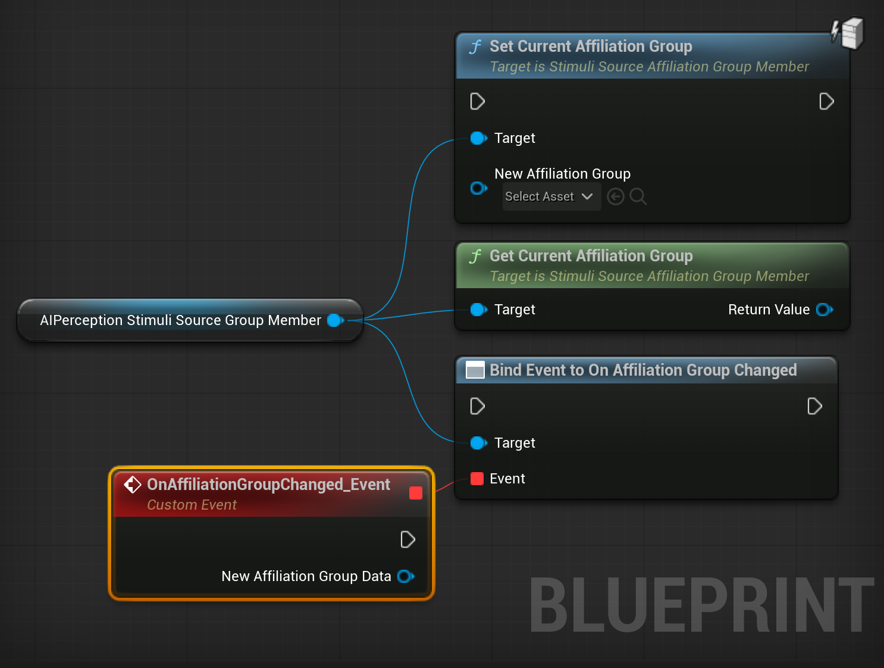
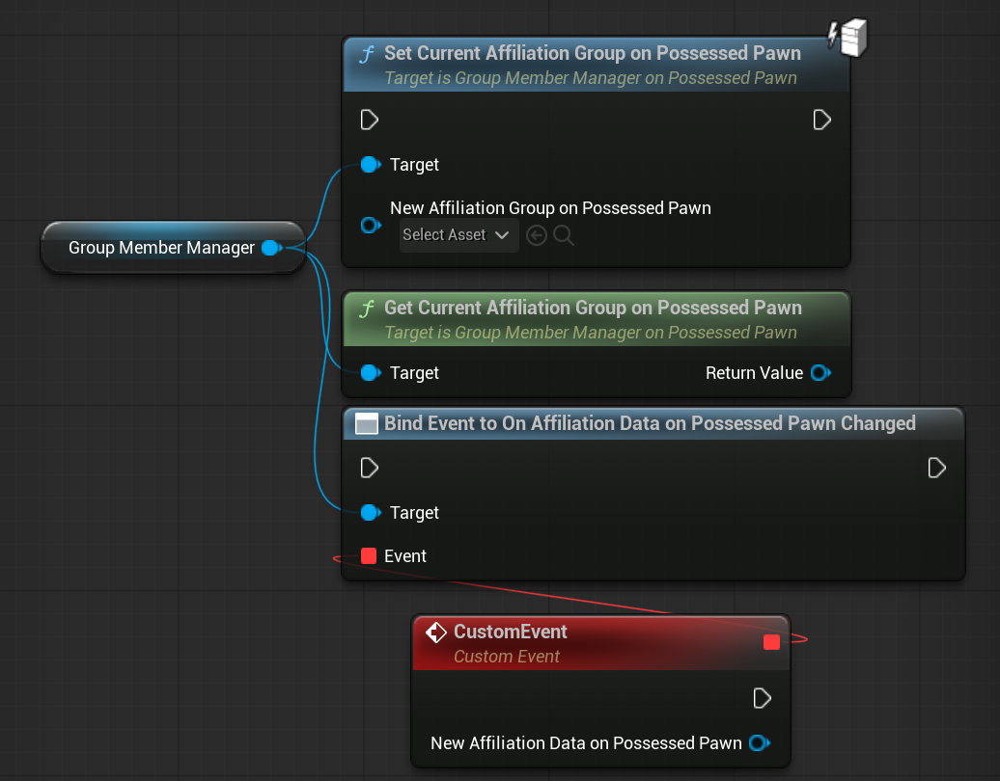
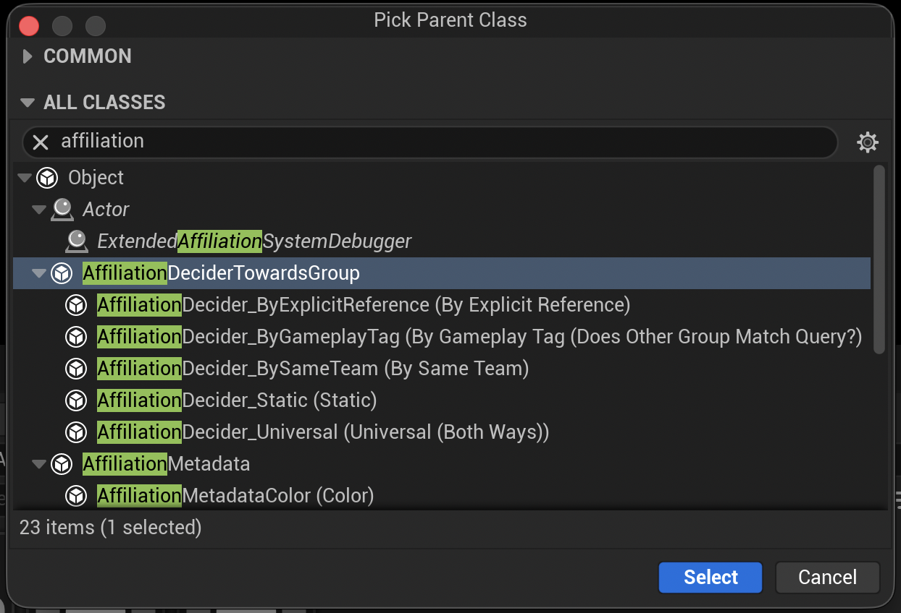
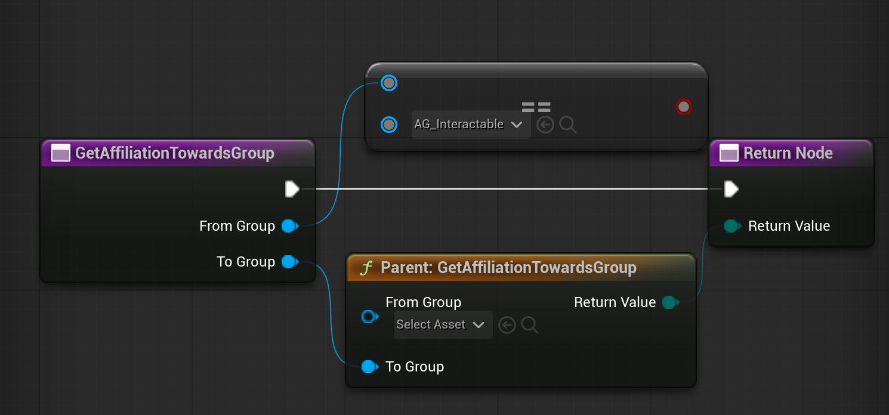

# Using the System

## Asking Questions

These nodes work in any Blueprint, under *Affiliation System*:

| Node | What it answers |
| --- | --- |
| **Get Affiliation Attitude Towards Actor** | How does actor A see actor B? |
| **Get Affiliation Group Data From Actor** | Which group is this actor in? |
| **Get Actors By Affiliation Attitude** | Which of these actors are *Hostile* (or Friendly, or Neutral) to me? |
| **Get Affiliation Query Matching Actors** | Which of these actors have these tags? |

The filter nodes are handy after an overlap, a trace or an AI Perception update. Actors without a group are skipped.

---

## Changing Groups

Call **Set Current Affiliation Group** on the actor's component, or **Set Current Affiliation Group On Possessed Pawn** on a controller's manager.

:::note Server only
Only the server can change groups (the small server icon on the nodes). The new group is replicated to every player.
:::

To react to a change, bind **On Affiliation Group Changed** (component) or **On Affiliation Data On Possessed Pawn Changed** (manager). They fire on the server and on every client, so they're the right place to update team colors or nameplates.

---

## Multiplayer Teams

The plugin works as a team system out of the box. A Red vs Blue setup:

1. **Create two groups,** *AG_Team_Red* and *AG_Team_Blue*, each Friendly to itself and Hostile to the other (see [Setup](./Setup.md#pick-a-decider)).
2. **Add the Group Member Manager** to your *Player Controller*, and the *Stimuli Source Affiliation Group Member* component to your character.
3. **Pick a team when a player joins.** In your *Game Mode* (it only runs on the server), on *Event OnPostLogin*, get the new player's *Group Member Manager* and call *Set Current Affiliation Group On Possessed Pawn* with Red or Blue.
4. **Stop friendly fire.** Before applying damage, call *Get Affiliation Attitude Towards Actor* from the attacker to the target, and only apply it when the answer is *Hostile*.
5. **Show teams.** On each client, bind *On Affiliation Group Changed* on the character's component and color the nameplate or outline.

<!-- TODO: screenshots of steps 3 and 4 (Game Mode OnPostLogin → Set Current Affiliation Group On Possessed Pawn, and the friendly fire check) -->

:::tip
Other players' controllers don't exist on your machine, so on clients read teams from the **character's component**, not from the controller.

For team colors, store a **Color** in the group's *Metadata Map* and read it with *Get Metadata By Class*. The *Debug Color* is only available in the editor.
:::

For a free-for-all, put every player in one group with the **By Same Team** decider and set its *Same Team Attitude* to Hostile.

---

## Writing Your Own Decider

If the built-in rules aren't enough, make your own:

1. Create a Blueprint class with **Affiliation Decider Towards Group** (or any built-in decider) as its parent.

   

2. Override **Get Affiliation Towards Group**. You get *From Group* (this group) and *To Group* (the other group), and return an attitude. Call *Parent* to fall back to the parent's answer.

   

3. Pick your decider in a group's **Affiliation Decider** dropdown.

:::warning Deciders only answer questions
Don't change anything in a decider: no spawning, no setting variables, no events. It is called often, and also in the editor for the preview.
:::
