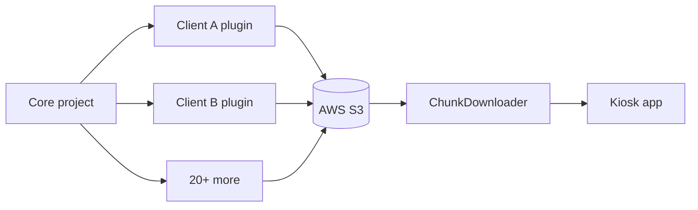
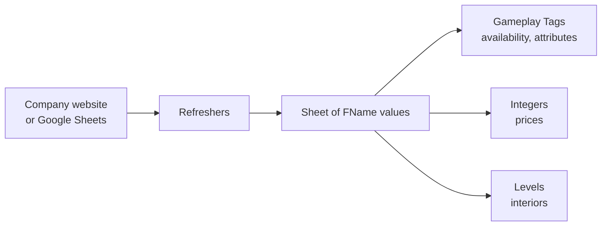

## Content delivery

Clients changed their content often, the interiors especially, and wanted to show their own customers the
latest version straight away. Getting every change to them took time and back and forth on both sides.
Splitting each client's content into its own plugin, delivered on demand, turned an update into something
the client simply received the next time they opened their project.

The core project holds the shared features, tools and optimisations. Each client's content is a Game Feature
plugin on AWS S3. The kiosk app signs clients in with their company email, shows only their projects, and
uses my extended ChunkDownloader to fetch the latest version of a project when it's opened.

It paid off in both directions: clients saw their changes sooner and needed less back and forth with us,
and work on the core, from optimisations to new assets, improved every client's project at the same time.

## OnlineAttributeSheet

Most of what a visualisation shows changes after it ships: prices, which apartments are still available,
the interiors on offer. I wrote a plugin, **OnlineAttributeSheet**, so none of that needed a rebuild.

- **Refreshers** are UObjects that fetch a sheet of values from a source: Google Sheets, or in our case the
  company website.
- **Values are stored as `FName`s**, which keeps refreshing cheap, and converted on demand into whatever a
  system needs: Gameplay Tags for availability and extra attributes, integers for prices, or levels.
- **Custom Blueprint nodes** read the last refreshed value as the type you ask for.
- **It works in the editor too**, so the live values are there while building the project, not only at runtime.

For example, each apartment's interior is mapped to a sheet value: pressing **Virtual Tour** on an
apartment loads that interior as a Level Instance to walk through. The sheets ended up everywhere in the
project, from sign-in details to the points of interest shown around a development, such as hospitals and
bus stops.

## Built with

Unreal Engine 5 and C++, with Game Features, World Partition, Mass, Cesium, MetaHumans, Common UI and UI
materials. Content was delivered from AWS S3, and the team
worked in Plastic SCM.
