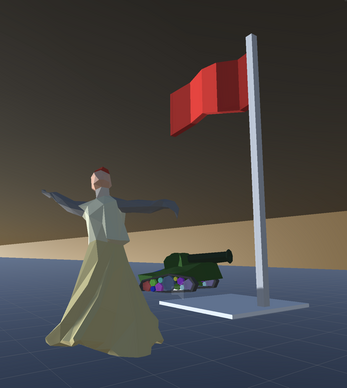
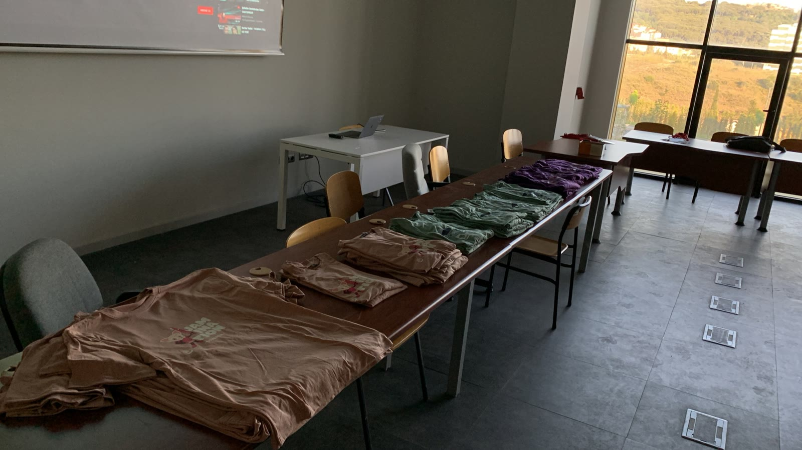

## The idea

Jamination 5 ran for 48 hours, from 27 to 29 May 2022, with
[34 games entered](https://itch.io/jam/jamination-5/entries). The theme was *Every input does two
things*. At the time, a song called *Mesneviden Ders Aldım* was everywhere on social media, and our team
could not stop joking about it. Somewhere in there the idea arrived: a semazen, the whirling dervish, who
never stops spinning. One input, two things: hold it and he moves forward the way he's facing, let go and
he spins the other way.

Then we asked the obvious next question: what is the least fair opponent for a spinning man in a robe?
A tank. Obviously a tank.

The result is a local capture the flag for two players on the same PC. You grab the other player's flag
and carry it back to your own platform, which only counts if your own flag is still sitting there, and
you try not to die on the way. First to three wins. Our artists and
programmers built several levels for it, from a desert to a grassy maze, so the battlefield keeps
changing even when the dervish doesn't stop.

## What I built

I programmed the characters' movement, the input for both players and the projectiles. The other two
programmers wrote the UI and the game manager with the win conditions, and our artists made the levels,
the models and the music.

Then something rare happened at a game jam: we finished early. With six hours to spare, instead of
sleeping like a reasonable person, I added a power-up system: a speed boost, a shorter cooldown between
shots, and a size decrease.

The [source is on GitHub](https://github.com/mrsagcan/semawar), a Unity 2021.3 project. Read it at your
own risk (see *Looking back*).

## The music

[breadcred](https://breadcred.itch.io/) wrote an 8-bit track inspired by *Mesneviden Ders Aldım*, and it
is a banger. It's the first thing people remember, and together with the, let's say, *unusual* setting,
it's what made Semawar stand out when we showed it to our own community and to the online Jamination 5
community.

## Bringing the jam to Marmara University

Jamination 5 ran at four venues in İstanbul at the same time, plus online on Discord, organised by game
development clubs from universities around Türkiye. İstanbul Technical University handled the technical
side of the jam. As the founder of the Marmara University game development club, my job was the place
itself: I organised the event at our university, which
[Mobidictum's preview of the jam](https://mobidictum.com/tr/jamination-5-game-jam-turk-oyun-gelistiricileri-bir-araya-getiriyor/)
lists at the Faculty of Technology in Maltepe, together with the university's computer engineering club,
MACSEC. That meant talking with the dean and the university to get the building for the weekend,
and helping find sponsors, which got everyone a Jamination 5
T-shirt, so at least everybody went home with something that fit. Over 50 people joined us there.

*The T-shirts, neatly folded. They stayed that way for about five minutes.*

## Looking back

I'm not proud of the code. It was written in 48 hours, and it shows. But people really wanted to play it,
and they enjoyed it, and that part I'm very proud of.

Made by [Aenin](https://aenin.itch.io), [elmarath0](https://elmarath0.itch.io) (me),
[gittem01](https://gittem01.itch.io), [fathizubinof](https://fathizubinof.itch.io),
[breadcred](https://breadcred.itch.io) and [benes](https://benes.itch.io).
